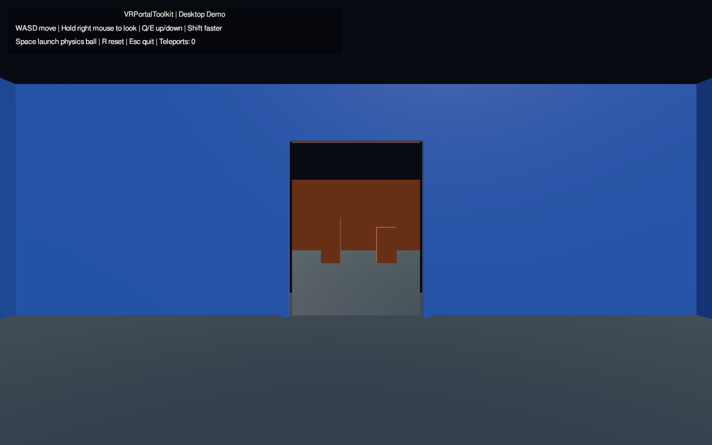
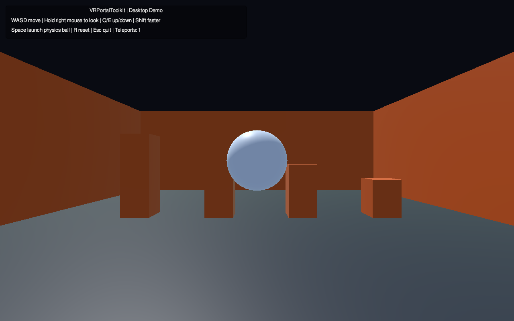

# VRPortalToolkit Desktop Demo

基于原版 VRPortalToolkit 的 Linux 桌面演示，使用项目自带的 BasicPortalPair、URP 门户渲染及 Portable 传送组件。两个房间通过门户连接，可移动视点穿越门户，也可发射物理球穿越门户。

原有 PointAndPortal、ExtendedReach、PortalOverlays 和 Raycaster 示例场景保留在 Assets/VRPortalToolkit/Examples/Scenes。

## 环境

- Unity Editor 2020.3.49f1c1（Linux），已通过 Unity Hub 激活有效许可证。
- Ubuntu 22.04 或兼容 Linux 桌面环境。
- 支持 Vulkan 的 GPU 和可用的 X11 显示会话。
- 包依赖由 [manifest.json](Packages/manifest.json) 定义，包括 URP 10.10.1 和 XR Interaction Toolkit 2.3.2。

Unity 2020 的 C# 编译器使用 OpenSSL 1.1。安装脚本会从 Ubuntu 官方软件源将兼容库解包到项目的 .tools 目录。

## 直接运行预编译版

从 [Releases](https://github.com/funcdecl/VRPortalToolkit/releases) 下载 Linux x86_64 压缩包，在 Linux 图形会话中解压并运行：

```bash
tar -xzf VRPortalToolkit-Linux-x86_64.tar.gz
./VRPortalDemo.x86_64 -force-vulkan -screen-fullscreen 0
```

预编译版运行时不需要安装 Unity Editor。

## 编译和运行

在 Linux 服务器上进入项目根目录：

```bash
export UNITY_EDITOR=/path/to/Unity/Editor/Unity
bash scripts/install-unity-compat.sh
bash scripts/build-linux.sh
export DISPLAY=:0
bash scripts/run-linux.sh
```

生成的程序位于 Builds/Linux/VRPortalDemo.x86_64。构建日志位于 Logs/build-linux.log。

在 Unity Editor 中，也可使用菜单 VR Portal > Create Desktop Demo 创建并打开桌面演示场景。

## 操作

| 按键 | 功能 |
| --- | --- |
| W / A / S / D | 前后左右移动 |
| 按住鼠标右键并拖动 | 调整视角 |
| Q / E | 降低 / 升高视点 |
| Shift | 加速移动 |
| Space | 发射可穿越门户的物理球 |
| R | 回到初始视点 |
| Esc | 退出 |

## 自动验收

```bash
bash scripts/smoke-linux.sh
```

验收在实际渲染的 Linux 程序中执行：检查成对门户的连接与门户内景渲染，让相机和物理球实际穿过门户，并核对到达出口房间的位置及视角。结果、运行日志和前后截图保存在 Artifacts/Linux，程序以退出码 0 表示验收通过。

## 运行验证

验证环境：Ubuntu 22.04、NVIDIA GeForce RTX 4090、Vulkan。

| 项目 | 结果 |
| --- | --- |
| 门户内可见出口房间 | 通过 |
| 相机穿越并到达出口房间 | 1 次，通过 |
| 物理球穿越并到达出口房间 | 1 次，通过 |
| 运行时错误 | 0 |

[验收结果](docs/demo/smoke-result.json)




## 已知限制

桌面演示使用单目视图，Standalone XR 加载器默认关闭。原版 XR 示例需要在 XR Plug-in Management 中启用对应加载器，并使用配套头显和控制器。

## 来源与许可

上游项目：[WearableComputerLab/VRPortalToolkit](https://github.com/WearableComputerLab/VRPortalToolkit)，采用 MIT 许可。作者与完整许可见原项目 README 和 LICENSE。
