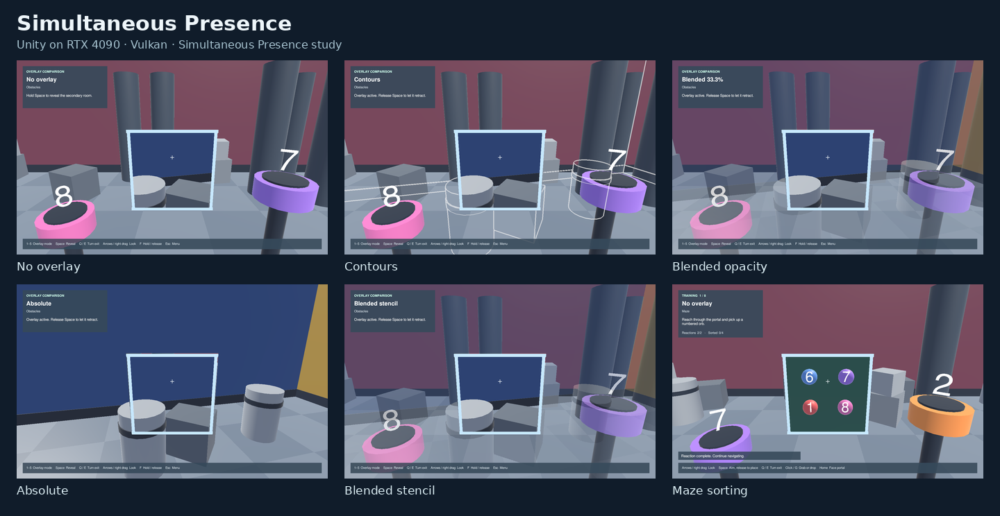

# Simultaneous Presence 论文复现

本工程在 VRPortalToolkit 的 Linux Demo 上实现《Simultaneous Presence Continuum: Portal Overlays for Overlapping Worlds in Virtual Reality》的门户叠加与实验任务。原有门户对、穿越变换和 URP 渲染树负责跨世界成像和取球，实验程序生成两类场景、管理试次并记录数据。

- Ablett, Cunningham, Lee & Thomas，IEEE TVCG 31(10)，7834–7847。[论文 DOI](https://doi.org/10.1109/TVCG.2025.3558178)
- 门户定位参考。[Point & Portal](https://doi.org/10.1109/ISMAR59233.2023.00026)
- 上游工程使用 MIT 许可。[WearableComputerLab/VRPortalToolkit](https://github.com/WearableComputerLab/VRPortalToolkit)

## 体验

启动后选 **Compare overlays** 比较同一位置的几种叠加。按住 Space 显示叠加，按 1–5 切换模式，按 M 切换迷宫与障碍环境。**Practice trial** 可以完整尝试导航、反应及分拣。

| 桌面操作 | 功能 |
| --- | --- |
| 方向键或按住右键拖动 | 转动主世界视角 |
| Space | 开启指针，预览落点，松开确认 |
| Q / E | 转动出口朝向 |
| 左键或 G | 朝向球时拿起，朝向编号容器时放下 |
| F | 松开或重新持握门户 |
| Home | 回到门户正面 |
| Esc | 返回菜单 |
| R | 重置练习 |

导航只移动次世界的门户出口。用弧线指针寻找可达的地面，朝薄荷色信标前进。反应提示响起时，出口位置锁定，先处理主世界出现的球。完成两个反应任务并抵达信标后，透过门户拿起四个球，放入相同编号的容器。放错的球回到原位。

## 渲染与激活

| 条件 | 视觉效果 | 正式试次 |
| --- | --- | --- |
| No overlay | 次世界仅出现在门户窗口内 | 是 |
| Contours | 50% 白色轮廓，使用颜色、深度和法线边缘 | 是 |
| Blended | 次世界以 1/3 不透明度叠加 | 是 |
| Absolute | 门户窗口外也显示完整的次世界画面 | 是 |
| Blended stencil | 屏幕空间三分之一像素选择次世界，其余保留主世界 | 比较和练习 |

门户静止时的窗口尺寸为 0.30 m × 0.30 m。定位时向下延展以露出指针。持握并开启指针，或出口在操作中移动至少 0.03 m 或转过至少 5°，触发叠加。停用指针且无出口操作 2 秒后开始收回，松手也开始收回。圆形过渡从窗口中心展开和收回，持续 0.5 秒。叠加期间，门户窗口保留其正常视图。次世界的墙体可触发动态近裁剪面，射线未命中墙体时使用相机近裁剪面。

## 实验流程和数据

在菜单选择参与者编号 01–25 后启动 **Start study protocol**。先完成每种技术的两项练习，再完成 24 个记录试次。正式设计为 4 技术 × 2 场景 × 3 区组。每种技术包含 6 个试次，两种场景交替。前 24 个编号对应不同的技术顺序，编号 25 使用固定种子抽取一个顺序。12 个编号先做迷宫，13 个先做障碍。

- **迷宫**为 7×7，每格 1.5 m。每个主路径有 7 次转弯，另有两个可见死路。共 16 个版本及 1 个统一练习版本。
- **障碍场景**为 20×20，每格 1 m。开始位置与终点相距 14–16 m。入口观测朝向与终点至少相差 90°。柱、箱、叠箱和桶的平面偏移不超过 0.25 m。
- **主世界**为 9×9，每格 1 m。八个彩色编号容器顺序每试次变动。正式试次记录两次反应和四个正确分拣。

程序完成每个试次后把数据追加到 `trials.jsonl`。默认目录为 Unity 的 `persistentDataPath/Studies`，可用 `-presence-output /path/to/studies` 指定。记录包含技术、场景、区组、布局编号、种子、输入方式、导航/选择/放置用时、错误、叠加时长占比和头部朝向通过门户的时长占比。导航时间从开始到最后一次调整出口，扣除其间的反应任务；反应的选择与放置时间分别记录。方向错误来自迷宫里连续后退至少 1 m。

每完成一种技术，记录员可把问卷得分填入会话目录中的 `questionnaires.csv`。按原量表计分后分别填写主/次世界的一般与空间临场感、真实感、参与度、Raw NASA-TLX 六项、SUS 和 SSQ。技术偏好按 1–4 排名填入 `preference.csv`。临场感连续体的两轴分别使用对应世界的一般和空间临场感均值。

```bash
python3 scripts/summarize-presence.py /path/to/studies/P01-* --out Artifacts/PresenceSummary
```

分析输出各技术、场景和指标的样本数、均值、标准差及和。问卷四项临场感得分齐全时，额外导出 `sp-continuum.csv`。正式分析按输入方式分组。自动验收数据有独立标记，只有指定 `--automated` 才能汇总。

## 4090 验收

在 Ubuntu 22.04 的 RTX 4090 上使用 Vulkan 运行 Linux Player。程序完成 8 次练习、24 次正式试次、128 次取球与正确归类、64 次反应任务，检查到 64 次反应期间的出口锁定。门户的实际宽和高均为 0.30 m。缩放、闲置后收回、松手收回、指针落点和墙体动态裁剪均通过检查。

同视点截图中，透明混合的估计线性颜色权重为 33.52%，模板模式的次世界采样点占 33.32%。这些是渲染检查。自动试次用来验证实验程序，真人研究的主观分数来自问卷。



解压后的运行包也通过了键鼠操作验收。鼠标可以打开比较界面，数字键切换条件，Space 控制门户叠加。Enter 可以进入练习并开始试次。

[试次验收](docs/presence/smoke-result.json) · [像素测量](docs/presence/render-measurements.json) · [键鼠操作](docs/presence/interactive-comparison.png)

## Linux 构建与运行

Unity Editor 2020.3.49f1c1、URP 10.10.1，使用和桌面 Demo 相同的工具链。需要已激活的 Unity Editor、支持 Vulkan 的驱动和 X11 显示会话。

```bash
export UNITY_EDITOR=/path/to/Unity/Editor/Unity
bash scripts/install-unity-compat.sh
bash scripts/build-presence-linux.sh
bash scripts/run-presence-linux.sh
```

构建产物为 `Builds/PresenceLinux/VRPortalPresence.x86_64`，日志为 `Logs/build-presence.log`。出现激活提示时在 Unity Hub 登录并启用许可证。已经构建的 Linux Player 可以直接在图形会话中运行。

验收命令会在实际渲染的程序中检查激活/退出与裁剪，保存各条件截图，并用脚本驱动真实的导航、射线选球、错误归位、反应锁定和试次切换。

```bash
bash scripts/run-presence-linux.sh -presence-smoke "$PWD/Artifacts/PresenceSmoke" \
    -logFile "$PWD/Artifacts/PresenceSmoke.log"
```

## OpenXR

在支持 OpenXR 的 Unity 主机打开 `Assets/VRPortalToolkit/PresenceStudy/SimultaneousPresence.unity`。源工程可通过 **VR Portal → Create Simultaneous Presence Study** 生成该场景。在 **XR Plug-in Management** 中为目标平台启用 OpenXR 和对应手柄交互配置。主手握持门户，上推主手摇杆瞄准，松开摇杆确认，左右转动出口。另一只手用射线和扳机拿放球，用主按钮开始或继续。命令行 `-presence-left` 切换主手，`-presence-protocol -presence-participant 1` 直接进入指定编号的实验流程。

## 已知差异

论文使用 Unity 2021.3.15f1、Quest Pro 和 2.5 m × 2.5 m 物理活动区。本工程保留已有 Unity 版本，并提供键鼠和 OpenXR 射线控件。桌面验证使用单目，头部朝向时长是视线方向的近似指标。布局、提示调度和美术以论文描述生成。自动验收的用时只用于检查流程，临场感和其他主观结果由真实参与者问卷获得。
